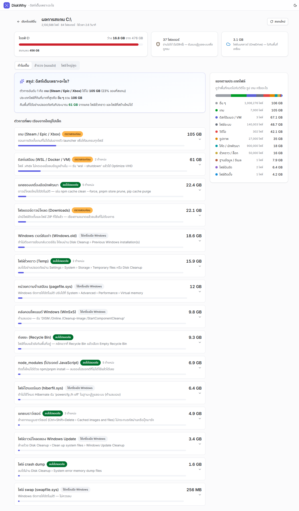

# DiskWhy — ดิสก์เต็มเพราะอะไร

แอปเดสก์ท็อป Windows ที่สแกนไดรฟ์แล้วตอบว่า **อะไรกินพื้นที่ อะไรลบได้อย่างปลอดภัย และควรจัดการอย่างไร**
สร้างด้วย Tauri 2 (Rust) + React 19 + Nova Design System

DiskWhy มี **CLI** (`diskwhy-cli`) และ **MCP server** ให้ Claude Code หรือ Claude Desktop ที่คุณใช้อยู่แล้วเรียกใช้ได้ โดยไม่ต้องตั้งค่าคีย์หรือบัญชีเพิ่ม ดูรายละเอียดที่ [docs/MCP.md](docs/MCP.md)

| | |
|---|---|
| ตัวติดตั้ง | `release/DiskWhy_0.1.0_x64-setup.exe` (≈2 MB, ติดตั้งแบบผู้ใช้ปัจจุบัน ไม่ต้องใช้สิทธิ์แอดมิน) |
| ความเร็วจริง | 2.67 ล้านไฟล์ / 167 GB ใน 73.6 วินาที (≈36,000 ไฟล์/วินาที, cold cache) |
| หน่วยความจำ | ≈31 MB ตอนเปิด |



DiskWhy อ่านข้อมูลจากเครื่องจริงเท่านั้น ไม่มีโหมดสาธิตหรือข้อมูลตัวอย่าง หากเปิดหน้าเว็บนอกแอปเดสก์ท็อป จะขึ้นหน้าให้เปิดใน DiskWhy แทน

## ฟีเจอร์

- **เลือกไดรฟ์ / โฟลเดอร์** — แสดงพื้นที่ใช้/ว่างของทุกไดรฟ์ เตือนเมื่อใกล้เต็ม
- **สแกนเร็วแบบหลายคอร์** (Rust + rayon) แสดงความคืบหน้าสด หยุดได้ทุกเมื่อ (Esc)
- **"ทำไมเต็ม"** — สรุปภาษาคน + ตัวการที่พบ เรียงตามขนาด พร้อมระดับความปลอดภัยและวิธีจัดการ:
  ถังขยะ, Temp, Windows Update, Windows.old, WinSxS, node_modules, แคชนักพัฒนา (npm/pnpm/pip/gradle/nuget/cargo),
  แคชเบราว์เซอร์, Downloads, ดิสก์เสมือน WSL/Docker (.vhdx), เกม, crash dump, hiberfil/pagefile/swapfile
  และตัวการที่ตรวจจับข้อมูลที่ไม่ได้ใช้:
  - ไฟล์ใหญ่ที่ไม่ได้แตะเกิน 1 ปี
  - โปรเจกต์เก่าที่ยังมี node_modules/build (ลบเฉพาะส่วนที่สร้างใหม่ได้)
  - ไฟล์ติดตั้งเก่าใน Downloads
  - ข้อมูล AppData ของโปรแกรมที่ถอนการติดตั้งแล้ว (เทียบกับรายการโปรแกรมใน Registry)
- **ใช้กับ Claude ผ่าน MCP** — Claude อ่านผลการสแกน อธิบายว่าทำไมเต็ม และเสนอแผนเคลียร์ที่ปลอดภัย ทุกการลบต้องได้รับการยืนยันจากคุณก่อน (ดูหัวข้อด้านล่าง)
- **แยกตามประเภทไฟล์** — วิดีโอ รูป เกม ไฟล์ติดตั้ง ดิสก์อิมเมจ ฯลฯ
- **แผนผัง Treemap** คลิกเจาะลึกทีละโฟลเดอร์ + รายการเรียงตามขนาด + breadcrumb (Backspace = ขึ้นหนึ่งระดับ)
- **ไฟล์ใหญ่สุด 100 อันดับ** — ดูในแผนผัง / เปิดใน Explorer / ย้ายไปถังขยะ
- **ปลอดภัยโดยออกแบบ** — อ่านอย่างเดียวเป็นค่าเริ่มต้น ไม่ส่งข้อมูลออกนอกเครื่อง ลบได้เฉพาะ "ย้ายไปถังขยะ" (กู้คืนได้) และบล็อกตำแหน่งระบบ (C:\Windows, Program Files, ราก drive, pagefile ฯลฯ) ที่ฝั่ง Rust
- **นับถูกต้อง** — ไม่ตาม symlink/junction (ไม่นับซ้ำ ไม่วนลูป), ไฟล์ OneDrive แบบ online-only แยกออก (ไม่กินพื้นที่จริง)
- ธีมสว่าง/มืด, UI ภาษาไทยเต็มรูปแบบ, ใช้คีย์บอร์ดได้ทั้งหมด

## ใช้กับ Claude ผ่าน MCP (ไม่ต้องตั้งค่าคีย์ใด ๆ)

DiskWhy ไม่มีระบบ AI ของตัวเอง แต่ทำตัวเป็น **MCP server** ให้ Claude Code หรือ Claude Desktop ที่คุณใช้อยู่แล้วเชื่อมต่อและเรียกใช้เครื่องมือของ DiskWhy แทนคุณ
ใช้ subscription เดิมของคุณ ไม่มีค่าใช้จ่ายเพิ่มจาก DiskWhy

**เชื่อมต่อ (ทำครั้งเดียว)**

1. เปิด DiskWhy แล้วกดปุ่ม **"เชื่อมต่อ Claude (MCP)"** เลือก Claude Code หรือ Claude Desktop
2. ถ้าใช้ Claude Desktop ให้ปิดแล้วเปิดใหม่ (Restart) หนึ่งครั้ง
3. ทดสอบด้วยคำขอ เช่น "ใช้ diskwhy ตรวจไดรฟ์ C: ว่าทำไมเต็ม แล้วเสนอแผนเคลียร์ที่ปลอดภัย"

ต้องการเพิ่มเองด้วยคำสั่ง หรือแก้ไข config ด้วยมือ ดูขั้นตอนใน [docs/MCP.md](docs/MCP.md)

**ตัวอย่างคำขอ**

- "ใช้ diskwhy ตรวจไดรฟ์ C: ว่าทำไมเต็ม แล้วเสนอแผนเคลียร์ที่ปลอดภัย"
- "หาไฟล์ที่ไม่ได้ใช้เกิน 1 ปีใน C:\Users"
- "ล้างแคช npm และ pnpm ให้หน่อย"

**การควบคุมและข้อมูลที่ไปถึง Claude**

- DiskWhy อ่านเฉพาะชื่อ ขนาด และวันที่แก้ไขของไฟล์ ไม่อ่านเนื้อไฟล์ และไม่เชื่อมต่อเครือข่ายภายนอก
- ผลลัพธ์ของเครื่องมือ (เช่น พาธและชื่อไฟล์) จะถูกส่งให้ Claude ประมวลผลตามการทำงานปกติของ Claude Code / Claude Desktop
- เครื่องมือที่ลบหรือเปลี่ยนแปลงไฟล์ถูกทำเครื่องหมายว่าเป็นการทำลาย (destructive) Claude จะถามคุณก่อนรันทุกครั้ง
- การลบปกติย้ายไปถังขยะ (กู้คืนได้) ทางเดียวที่ลบถาวรคือการล้างถังขยะ และต้องยืนยันก่อนเช่นกัน
- คำสั่งที่ต้องใช้สิทธิ์ผู้ดูแลระบบ (เช่น DISM, `powercfg /h off`) DiskWhy จะแสดงให้คุณรันเองเท่านั้น ไม่รันให้

## CLI

```
diskwhy-cli drives                        # แสดงไดรฟ์และพื้นที่ว่าง
diskwhy-cli report <PATH> [--json] [--top N]   # สแกนแล้วสรุปว่าทำไมเต็ม
diskwhy-cli unused <PATH> [--json]        # หาไฟล์/โปรเจกต์/ตัวติดตั้งที่ไม่ได้ใช้
diskwhy-cli top <PATH> [--limit N] [--json]    # ไฟล์ใหญ่สุด
diskwhy-cli cleanup <ACTION> [--yes]      # รันการล้างที่อนุญาต (--yes ยืนยันไปเลยโดยไม่ถามซ้ำ)
diskwhy-cli mcp                           # เริ่ม MCP server ผ่าน stdio
```

`--json` ใช้ให้โปรแกรมอื่นอ่านผลลัพธ์ได้ ค่า `<ACTION>` ของ `cleanup` ต้องอยู่ในรายการที่อนุญาตเท่านั้น (ดู [docs/MCP.md](docs/MCP.md))

## โครงสร้าง (monorepo, pnpm + Turborepo, Cargo workspace)

```
apps/diskwhy/            แอป DiskWhy (Cargo workspace + Tauri + React)
  crates/core/                ไลบรารีกลาง: สแกน, กฎตรวจจับ, กฎความปลอดภัย, คำสั่ง Windows ที่อนุญาต
    src/scan.rs                 ตัวสแกนแบบขนาน + ต้นไม้ในหน่วยความจำ
    src/insights.rs             กฎตรวจจับตัวการ, หมวดไฟล์, ตัวตรวจข้อมูลที่ไม่ได้ใช้, ไฟล์ใหญ่สุด
    src/installed.rs            รายการโปรแกรมที่ติดตั้ง (อ่าน Registry อย่างเดียว)
    src/report.rs               สแกน + สร้างรายงาน + ข้อมูลไดรฟ์
    src/safety.rs               ตำแหน่งที่ห้ามแตะ, ย้ายไปถังขยะ, ตรวจตำแหน่งกับผลสแกน
    src/actions.rs              เครื่องมือ Windows ที่อนุญาต (whitelist)
  crates/cli/                 diskwhy-cli: คำสั่ง CLI + MCP server (stdio)
  src-tauri/                  เปลือกแอปเดสก์ท็อป: Tauri commands + event stream
  src/                        UI (React): Treemap, SizeList, Insights, Screens, Results
apps/docs/               Storybook 10 — เอกสาร Design System
packages/tokens/         Design tokens (W3C DTCG → CSS / Tailwind v4 / JS / Figma) + WCAG contrast gate
packages/ui/             คอมโพเนนต์ React (Radix + Tailwind v4) ที่แอปใช้
registry/                shadcn registry ของคอมโพเนนต์ Nova
```

## พัฒนาต่อ

ต้องมี Node ≥ 22, pnpm 11, Rust (stable/nightly), Visual Studio Build Tools 2022 (C++), WebView2

```bash
pnpm install
pnpm --filter @nova/diskwhy app:dev     # เปิดแอปเดสก์ท็อปแบบ hot-reload
pnpm --filter @nova/diskwhy dev         # เปิด UI ในเบราว์เซอร์ (จะขึ้นหน้า "เปิดใน DiskWhy" เพราะไม่มี backend)
pnpm --filter @nova/diskwhy app:build   # สร้างตัวติดตั้ง .exe (NSIS)
```

ทดสอบ:

```bash
pnpm test                                                                   # tokens + UI + DiskWhy (TS)
cd apps/diskwhy && cargo test --workspace                                   # core + cli + src-tauri (Rust)
cd apps/diskwhy && DISKWHY_BENCH='C:\' cargo test --release bench_real -- --ignored --nocapture   # วัดความเร็วจริง (อ่านอย่างเดียว)
```

เทสต์ MCP เป็น integration test ที่เปิดตัว `diskwhy-cli` เป็นโปรเซสลูก แล้วคุยกับมันผ่าน stdio ไม่เรียก Claude และไม่ต้องใช้บัญชีใด ๆ

ดูรายละเอียดสำหรับทีมที่ [docs/HANDOFF.md](docs/HANDOFF.md) และรายละเอียด MCP ที่ [docs/MCP.md](docs/MCP.md)
